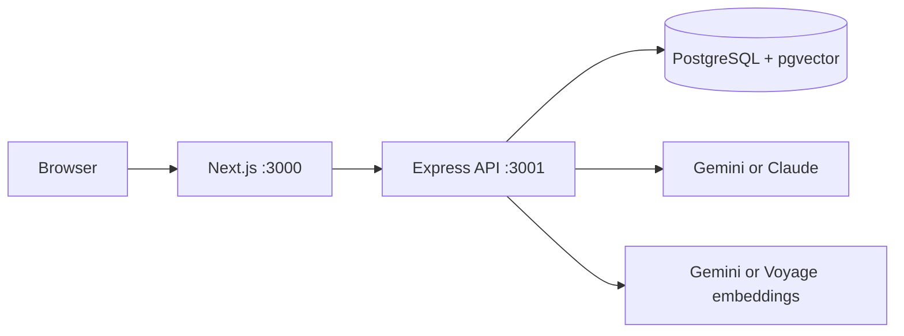

# Doctor Booking Demo

A demo doctor appointment platform with an AI patient assistant, running on **dummy data**.

- Natural-language doctor search (specialty, city, date, time of day)
- FAQ answers with citations, using RAG over clinic documents (pgvector)
- Appointment summaries and message drafts (nothing is ever sent)

**Safety design**

- Availability and booking are plain backend code with DB transactions and a unique index. The LLM never reads or writes slots and never confirms a booking.
- The AI never diagnoses. Emergency wording is detected in code before any LLM call and returns a fixed message.
- Every LLM output is validated with Zod, retried once, then replaced by a safe fallback.
- FAQ answers must cite retrieved passages. Otherwise the answer is "not found".

## Architecture



## Quick start (Docker)

```bash
cp backend/.env.example backend/.env     # add GEMINI_API_KEY (or the keys for your providers)
cp .env.example .env
docker compose up --build -d db
docker compose --profile setup run --rm setup   # migrations, dummy data, FAQ embeddings
docker compose up --build -d
```

Open http://localhost:3000.

`setup` resets the dummy data, including bookings, every time it runs.

## Local development

```bash
docker compose up -d db
cd backend && pnpm install && pnpm prisma migrate deploy && pnpm db:seed && pnpm db:embed && pnpm dev
cd frontend && pnpm install && pnpm dev
```

## Tests

```bash
cd backend && pnpm typecheck && pnpm test    # needs the DB running and seeded; no AI keys or network
cd backend && pnpm smoke:ai                  # optional: real AI calls
```

## API

| Method | Path                                | Purpose                         |
| ------ | ----------------------------------- | ------------------------------- |
| GET    | /api/health                         | Health check                    |
| GET    | /api/doctors?specialty=&city=&date= | Search doctors                  |
| GET    | /api/doctors/:id/slots?date=        | Free slots                      |
| POST   | /api/assistant/search               | Natural-language search         |
| POST   | /api/assistant/faq                  | FAQ answer with sources         |
| POST   | /api/appointments                   | Book `{ patientId, slotId }`    |
| DELETE | /api/appointments/:id               | Cancel                          |
| GET    | /api/appointments/:id/summary?type= | Summary and message draft       |
| GET    | /api/patients                       | Demo patient picker (no emails) |

## Changing AI providers

Set `LLM_PROVIDER` and `EMBEDDING_PROVIDER` in `backend/.env`.
After changing the embedding provider or model, clear and rebuild the vectors:

```bash
docker compose exec -T db psql -U app -d doctor_booking -c 'UPDATE "FaqChunk" SET embedding = NULL;'
docker compose --profile setup run --rm setup   # or: cd backend && pnpm db:embed
```

## Known limitations

- Dummy data only; no authentication or real patient data. Check your provider's data-use terms before using real data.
- Slot times are stored in UTC and treated as clinic-local time.
- The browser API address is fixed at build time (`NEXT_PUBLIC_API_URL`).
- Emergency detection is a keyword list (English and French) and is not a substitute for medical triage.
- Demo DB credentials are `app`/`app`. Change them before exposing anything publicly.
